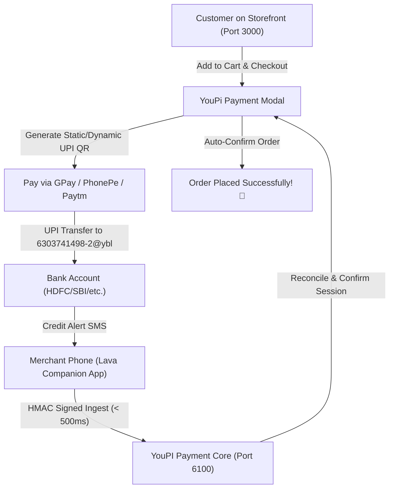

# Kirana Prototype & Automated Payment Gateway 🛒⚡

An end-to-end, production-grade Kirana e-commerce prototype with real-time inventory, persistent cart, interactive product review breakdown, and zero-fee automated UPI payment reconciliation powered by YouPI-PG.

---

## 🌟 Key Highlights

- **Modern Kirana Storefront**: Built with **React 18**, **Vite**, **Tailwind CSS**, and **Lucide Icons**.
- **Supabase Cloud Backend**: Real-time product catalog, categories, search, filter, and schema migrations.
- **Cart & Session Persistence**: Local storage synchronized cart with state retention across page refreshes.
- **Enhanced Product Details**: Interactive 6-month price trend tracker, rating breakdown, verified reviews, and FAQ accordion.
- **Zero-Fee Automated UPI Gateway (YouPI-PG)**:
  - Vector static and dynamic UPI QR code generator (`6303741498-2@ybl`).
  - Seamless customer checkout modal with WhatsApp OTP verification.
  - Zero manual button clicks or UTR entry needed for customer order confirmation.
- **Android SMS Companion Gateway**:
  - Native Android app (`youpi-sms-gateway.apk`) that intercepts incoming bank credit SMS in real time (< 500ms).
  - Streamlined low-density QR code pairing and manual connection support.
  - Automatic order placement upon credit SMS detection.
- **WhatsApp Berry Protocol**: Automated OTP verification and order confirmation alerts delivered directly to customer phones.

---

## 🏗️ System Architecture



---

## 📁 Repository Structure

```
Kirana-Prototype/
├── src/                          # React Kirana Storefront source
│   ├── components/               # UI components (Header, ProductCard, CartModal, etc.)
│   │   ├── YouPiPaymentModal.jsx # Zero-commission UPI payment modal
│   │   ├── ProductDetailPage.jsx # Enhanced product details screen
│   │   ├── ProductPriceHistory.jsx # 6-month historical price chart
│   │   └── ProductReviewsSection.jsx # Star distribution & reviews
│   ├── data/                     # Mock data & fallback catalogs
│   ├── lib/                      # Supabase client & utilities
│   ├── App.jsx                   # Main application controller
│   └── main.jsx                  # Entry point
├── public/                       # Static public assets
├── youpi-backend/                # YouPI Payment Gateway & Management Services
│   ├── apps/
│   │   ├── control-center/       # Process supervisor & port manager (8090)
│   │   ├── payment-api/          # Payment Core REST API & Poller (6100)
│   │   ├── checkout-portal/      # Customer checkout UI (7000)
│   │   ├── merchant-admin/       # Merchant Admin & Developer Hub (6001)
│   │   └── android-observer-app/ # Native Android Companion APK & source
│   ├── packages/
│   │   ├── common/               # Crypto, HMAC, secret resolver utilities
│   │   ├── core/                 # Parsing, QR generator, observation engines
│   │   └── db/                   # Database repositories & SQLite/Postgres ORM
│   └── scripts/                  # Development launcher (`dev.js`)
├── supabase-schema.sql           # Database tables, triggers, and seed data
└── package.json                  # Root dependencies & scripts
```

---

## 🚀 Quickstart Guide

### 1. Prerequisites
- **Node.js**: v20 or higher (v24 recommended)
- **Android Phone**: Android 8.0+ for companion SMS Gateway app (optional for automated verification)

### 2. Install Dependencies
```bash
# Install storefront dependencies
npm install

# Install payment backend dependencies
cd youpi-backend
npm install
cd ..
```

### 3. Environment Configuration
Copy `.env.example` to `.env`:
```bash
cp .env.example .env
```

### 4. Running the Storefront & Payment Engine
In terminal 1:
```bash
# Start YouPI Payment Gateway (ports 8090, 6001, 6100, 7000)
node youpi-backend/scripts/dev.js
```

In terminal 2:
```bash
# Start Kirana Storefront (port 3000)
npm run dev -- --host
```

- **Kirana Storefront**: [http://localhost:3000](http://localhost:3000)
- **Merchant Admin Panel**: [http://localhost:6001](http://localhost:6001)
- **Payment API Core**: [http://localhost:6100](http://localhost:6100)

---

## 📱 Android Companion SMS Gateway Setup

1. Download the companion APK from `youpi-backend/apps/merchant-admin/public/youpi-sms-gateway.apk` (or directly from `http://<laptop-ip>:6001/youpi-sms-gateway.apk` on your phone).
2. Install and launch **YouPI SMS Gateway** on your phone.
3. Open **Merchant Admin** (`http://localhost:6001`) → **Developer Hub** → **Android SMS Hub**.
4. Scan the pairing QR code or tap **Manual Connect** using:
   - **Gateway URL**: `http://<laptop-ip>:6100`
   - **Enrollment Token**: `android_pairing_enrollment_secret_key_32_chars`
5. The status turns to `● STATUS: PAIRED & ACTIVE`. Incoming bank credit SMS will now automatically settle checkout payments instantly!

---

## 🔒 Security & Privacy

- Cryptographic HMAC-SHA256 request signing on all mobile observer payloads.
- Replay drift protection and automatic token whitespace trimming.
- End-to-end sandbox fallback with SQLite for rapid zero-dependency local development.

---

## 📄 License
MIT © 2026 Tarun Paruchuri
